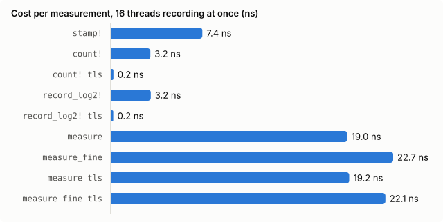

# brap

Low-overhead latency telemetry for hot code paths.
Optimized for low churn development where you want quick measurements
on the hot path without adding a lot of boilerplate or runtime cost.

Decorate functions for instant instrumentation with very low overhead.
Recording a sample is one cycle-counter read plus one relaxed atomic increment.
It never allocates, locks or formats anything.
Every site is collected into a link-time registry, so a consumer can find and
drain all of them without hand-maintained lists.
All instrumentation sits behind Cargo features and compiles away completely when disabled.

Requires x86_64: the clock is `rdtsc`.

## Setup

Declare `brap` as a feature in your crate.
Each optional *compile set* is one more `brap-<name>` feature:

```toml
[features]
default = ["brap-all"]
brap = ["brap/runtime"]
brap-all = ["brap-example"]
brap-example = ["brap"]

[dependencies]
brap = { version = "0.1", optional = true, features = ["runtime"] }
```

The macros check *your* crate's features, so they must be declared. If they
aren't, `rustc` warns `unexpected cfg condition value: brap` and records
nothing.

## Measure functions

```rust
const SCOPE: &str = "brap-example";

#[brap::measure_fine(name = "example-total", scope = SCOPE)]
fn example(input: &str) -> Result<u64, std::num::ParseIntError> {
    let trimmed = input.trim();
    brap::checkpoint!("example-stage-1"); // cycles since entry
    let value = trimmed.parse()?;
    brap::checkpoint!("example-stage-2"); // cycles since stage 1
    Ok(value)
}
```

`measure` uses a 64-bin log2 histogram. `measure_fine` uses a finer
mantissa histogram; set `precision = N` for N sub-bucket bits (default 4).
Both work on `async fn` and methods. Without `name`, a metric is named after
the function's path. Without `scope`, it uses the module path.

## Record existing deltas

```rust
let started = brap::stamp!(set = "example");
example_work();
brap::record_fine!(SCOPE, "example-span", brap::now_cycles() - started, set = "example");
```

With `set = "example"`, the site exists only when `brap-example` is
enabled. When the set is disabled, `stamp!` returns `0` without reading the
clock, and the `record_*!` expression is never evaluated.

## Count events

```rust
brap::count!(SCOPE, "example-events");        // +1
brap::count!(SCOPE, "example-items", n_items); // +n
```

A count site is found and drained like any other site and logs as
`kind=counter value=N`. Its snapshot's `sample_count` is the count. It
supports `set = "..."` and `storage = "tls"`, and when disabled the value
expression is not evaluated.

## Consume

Drain a scope yourself:

```rust
for snapshot in brap::access_scope(SCOPE) {
    brap::log_snapshot(snapshot);
}
```

Or start one background consumer at startup. It finds every shared site
(optionally limited to one scope), drains them on an interval, and does a
final flush when stopped:

```rust
let consumer = brap::consumer::build()
    .scope(SCOPE)
    .every(std::time::Duration::from_secs(10))
    .spawn()?;
// ...
consumer.stop().expect("stop telemetry consumer");
```

The default callback writes one logfmt line per metric to stdout:

```text
brap kind=histogram scope=brap-example metric=example-total count=4 min_cycles=408 p50_cycles=456 ... p99_us=2 max_us=2
```

Pass `.consume(|snapshot| ...)` to send snapshots somewhere else.
`brap::consumption_statuses()` reports how many times each site was drained
and how many samples were taken.

## Thread-local sites

`storage = "tls"` gives each thread its own non-atomic histogram, for
single-owner loops where even a relaxed atomic is too costly. The owner
thread registers and warms its sites before the loop, and must drain them
itself:

```rust
#[brap::measure(scope = SCOPE, storage = "tls")]
fn example_hot_step(value: u64) -> bool { /* ... */ }

let _owner = brap::TlsOwnerGuard::enter(SCOPE).warm();
```

## Owned metric sets

For metrics that a component owns, rather than one per callsite, derive a
plain struct and emit it when you choose:

```rust
#[derive(Default, brap::MetricSet)]
#[brap(scope = "brap-example")]
struct ExampleMetrics {
    example_counter: brap::Counter,
    example_gauge: brap::Gauge,
    example_summary: brap::Summary,
    example_histogram: brap::FineHistogram,
}

let mut metrics = ExampleMetrics::default();
metrics.example_counter.increment();
metrics.example_histogram.record(cycles);
brap::log_set(&metrics, &[brap::Field::u64("example_field", 1)])?;
```

`#[derive(brap::MetricKey)]` on an enum, combined with `brap::HistogramSet`,
gives a fixed array of histograms indexed by the enum's variants.

## Performance



Net cost of one measurement: the time per call of an instrumented empty
function minus the same function uninstrumented. Every thread records back to
back, which is the worst case for contention.

| Operation | 1 thread | 16 threads |
|---|---|---|
| `stamp!` | 8.7 ns | 7.4 ns |
| `count!` | 4.0 ns | 3.2 ns |
| `count! tls` | 0.4 ns | 0.2 ns |
| `record_log2!` | 4.0 ns | 3.2 ns |
| `record_log2! tls` | < 0.1 ns | 0.2 ns |
| `measure` | 23.5 ns | 19.0 ns |
| `measure_fine` | 22.6 ns | 22.7 ns |
| `measure tls` | 23.7 ns | 19.2 ns |
| `measure_fine tls` | 25.4 ns | 22.1 ns |

A `measure` call reads the clock twice (`stamp!`, about 8 ns each) and
increments one histogram bin. Shared sites keep 16 copies (shards) of their
histogram, and each thread increments its own copy, so up to 16 recording
threads don't contend. With more threads recording back to back, threads
share shards and the cost climbs (`measure` about 35 ns at 32 threads, 82 ns
at 60). `storage = "tls"` stays at about 20 ns at any thread count. Disabled
sites compile to nothing.

### Shard count

The shard count is fixed at compile time by the `BRAP_SHARDS` environment
variable. Each shard is a full copy of the histogram, so more shards cost
memory: per shared site, 512 B for log2 and about 7.8 KB for fine, times the
shard count.

```toml
# .cargo/config.toml in your project
[env]
BRAP_SHARDS = "64"  # default 16; "1" disables sharding
```

| `BRAP_SHARDS` | `measure`, 16 threads | `measure`, 60 threads |
|---|---|---|
| `1` (off) | 164 ns | - |
| `16` (default) | 19.0 ns | 82 ns |
| `64` | - | 20.4 ns |

Cargo rebuilds `brap` when the value changes. An invalid value is a compile
error.

AMD Ryzen Threadripper PRO 9995WX, rustc 1.96, measured with
[Criterion](https://github.com/bheisler/criterion.rs). To reproduce:

```sh
cargo bench --bench overhead
python3 benches/plot.py  # rewrites benches/overhead.svg, prints this table
```

## Examples

`brap-examples` is set up like a real downstream crate:

```sh
cargo run -p brap-examples --example measure     # measure, checkpoint!
cargo run -p brap-examples --example record      # stamp!, record_*!, compile sets
cargo run -p brap-examples --example consumer    # background consumer, many threads
cargo run -p brap-examples --example tls         # thread-local sites, owner guard
cargo run -p brap-examples --example metric_set  # MetricSet, MetricKey, HistogramSet

# Drop the `example` set, or all instrumentation:
cargo run -p brap-examples --example record --no-default-features --features brap
cargo run -p brap-examples --example record --no-default-features
```
